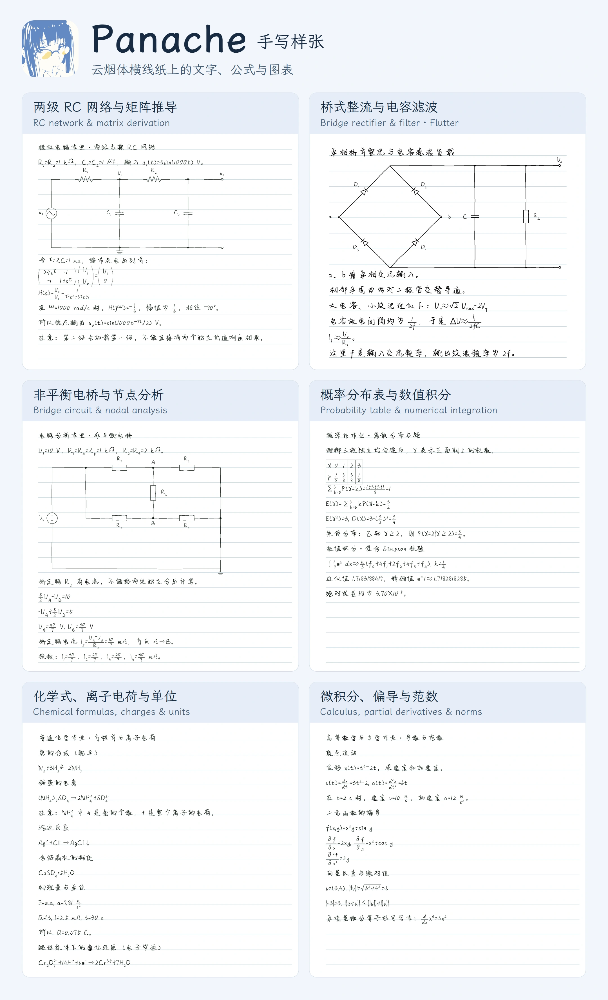
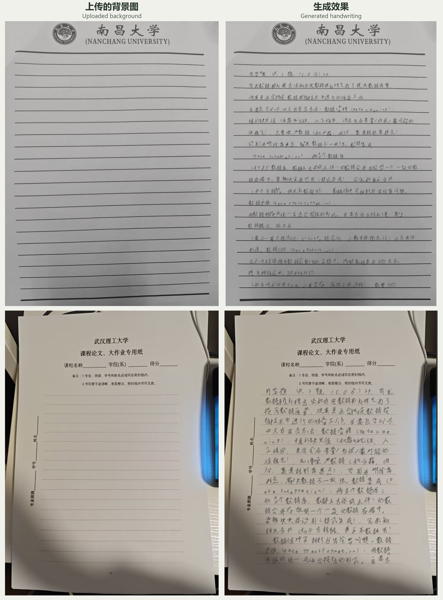
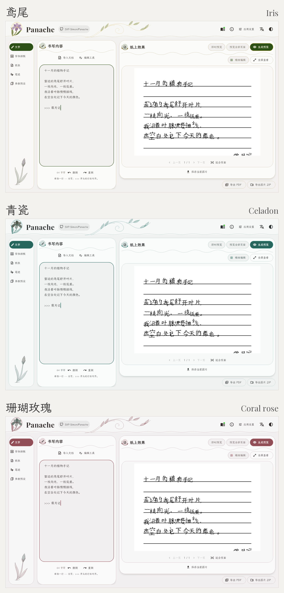
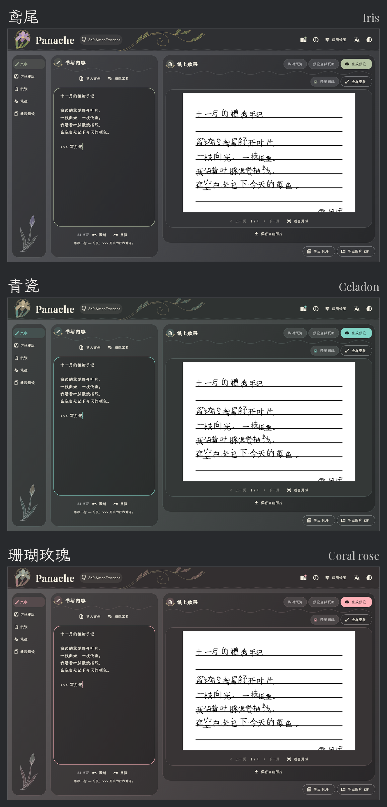

# Panache

[English](README_en.md)

> 老实写作业，很无聊吧

Panache 是基于 **Flutter + Rust** 的开源手写体生成器。把课堂笔记、实验报告里的正文、数学公式、表格和电路图排到纸上，再保存为手写稿。

[下载客户端](https://github.com/SXP-Simon/Panache/releases/latest) · [使用指南](app/README.md#功能入口) · [自行部署](deploy/rust/README.md)


<table>
  <thead>
    <tr>
      <th width="45%">云烟体横线纸效果</th>
      <th width="55%">自定义背景与生成效果</th>
    </tr>
  </thead>
  <tbody>
    <tr>
      <td align="center" valign="top"><a href="./docs/assets/images/panache-showcase.webp"></a></td>
      <td align="center" valign="top"><a href="./docs/assets/images/panache-custom-background.webp"></a></td>
    </tr>
  </tbody>
</table>

- Android / iOS：通过 Dart FFI 调用随包 Rust 引擎，支持离线生成。
- Windows / macOS / Linux：Flutter 原生界面自动启动随包 Rust sidecar，支持离线生成。
- Web：Flutter Web 连接 Rust HTTP 服务，服务可同时托管页面。

界面采用新艺术运动风格的 Material Design 3 主题。浅色工作台以暖白纸面为底。深色工作台在中性灰底上叠加半透明黑，用明暗区分导航、书写和预览区域。应用设置支持跟随系统、切换预设和自定义双色。界面标题使用 Playfair Display 和霞鹜文楷，纸张中的手写文字使用用户所选字体。手机工具入口同时显示图标和名称，生成任务可在工作台直接取消。

<table>
  <thead>
    <tr>
      <th width="50%">浅色工作台</th>
      <th width="50%">深色工作台</th>
    </tr>
  </thead>
  <tbody>
    <tr>
      <td valign="top"><a href="docs/assets/images/panache-themes-light-4afebd8c822b.webp"></a></td>
      <td valign="top"><a href="docs/assets/images/panache-themes-dark-256296ea03f2.webp"></a></td>
    </tr>
  </tbody>
</table>

模块边界与状态管理见 [客户端架构](docs/flutter-architecture.md)，移动工具链与 Windows 环境入口见 [移动开发环境](scripts/MOBILE_ENVIRONMENT.md)。

## 手写排版功能

- **正文和文档**　支持输入、粘贴或导入 TXT、DOCX、PDF、RTF，在光标处插入图片。单独一行 `---` 插入分页，以 `>>>` 开头的行右对齐。
- **理工科公式**　支持上下竖式分数、带横线的根式、矩阵、上下标和常见数学符号。主字体缺少字形时，使用备用字体补字。可直接渲染常见的 CircuiTikZ 电路。
- **Markdown 表格**　用「编辑工具 → 整理文本」清理粘贴的内容，选择手写方格、对齐文本或清单等表格格式。支持带格线的 LaTeX `array` 表格，单元格可以包含分数。
- **字体和纸张**　中英文字体可分别选择，数字可跟随英文字体。支持空白、横线、方格和点阵纸，也可以上传纸张照片，识别横线或手动框选书写区。
- **精细编辑和导出**　可预览单页或全部页面。点选或圈选一组字后，可移动、改笔迹或拉四角透视。手机支持全屏精细编辑。可保存单页 PNG，或导出 PDF 和图片 ZIP。

首次使用可在工作台打开「使用指南」，按**写内容 → 选字体 → 生成预览 → 导出**操作。

## 目录

```text
app/                         Flutter 客户端、平台工程与测试
assets/                      handwriting_assets package 与共享字体
crates/handwriting-core/     渲染、图片处理、文档导入与导出
crates/handwriting-bridge/   移动端 C ABI / FFI
crates/handwriting-server/   HTTP API、任务队列与静态托管
scripts/                     桌面、移动端和独立服务构建脚本
deploy/rust/                 Docker 与服务部署说明
.github/workflows/           Flutter / Rust 检查与打包
VERSION                      产品版本
```

## 开发

工具链：Flutter 3.47.5 / Dart 3.13.4、Rust 1.94.1；原生平台需安装相应 SDK。Python 仅用于原生构建脚本，应用运行不依赖 Python。

```bash
# 仓库根目录启动 Rust 服务，默认监听 127.0.0.1:5006
cargo run --locked -p handwriting-server
```

另一个终端：

```bash
cd app
flutter pub get
python3 ../scripts/build-text-worker.py
flutter run -d chrome --dart-define=API_BASE_URL=http://127.0.0.1:5006
# macOS 原生开发：自动构建并嵌入 Rust sidecar
flutter run -d macos
```

Web 跨 origin 开发需配置 `HANDWRITING_ALLOWED_ORIGINS`，详见 [部署说明](deploy/rust/README.md)。

## 构建与验证

```bash
cargo fmt --all -- --check
cargo clippy --locked --workspace --all-targets -- -D warnings
cargo test --locked --workspace
cd app
flutter analyze
flutter test
cd ..
python3 scripts/build-flutter-web.py
```

在仓库根目录构建独立桌面包或服务包：

```bash
python3 scripts/build-flutter-desktop.py
bash scripts/build-rust-service.sh
```

移动端构建、原生库集成、各平台签名与限制见 [Flutter 客户端说明](app/README.md)，Rust 架构见 [workspace 说明](crates/README.md)。正式包从通过检查的 `main` 构建，流程见[发布说明](docs/release.md)。

## 持续验证与反馈

`main` 分支推送与相关 pull request 按路径触发 Flutter 检查、Rust 跨平台检查，以及 Android/iOS 模拟器上的随包引擎集成测试。独立桌面打包保留 pull request 与手动入口。旧 Web/Electron 源码归档在 `backup` 分支。

问题与建议通过[GitHub Issues](https://github.com/SXP-Simon/Panache/issues)提交，客户端反馈入口会打开该页面。

## 来源与许可

项目基于 [handwriting-web](https://github.com/14790897/handwriting-web)。感谢 [HakimYu](https://github.com/HakimYu) 提供 Flutter/Rust 迁移。


项目许可见 [LICENSE](LICENSE)，移植算法的声明与许可见 [NOTICE](crates/handwriting-core/NOTICE)。客户端可在“关于与反馈 → 开源许可”查看项目、算法及已确认的 OFL 字体许可；服务包、桌面包和 Rust Docker 镜像同时携带 LICENSE 与 licenses/。

共享字体的授权依据及尚待确认的字体见 [字体许可记录](assets/licenses/FONT-LICENSES.md)。项目 MIT 许可不覆盖第三方字体；保留字体文件不代表已取得其商用或再分发授权。
