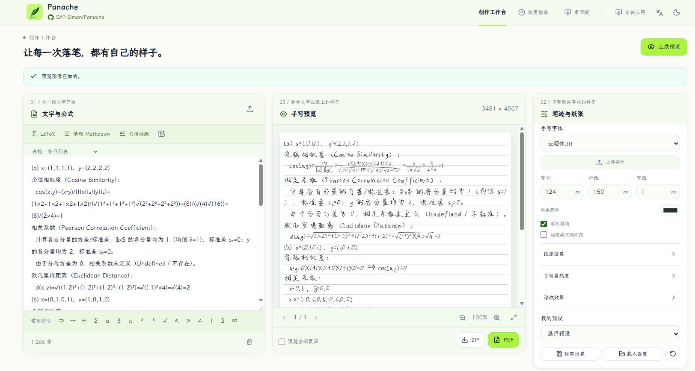

# Handwriting Web (Simon's Enhanced Edition)

> 老实写作业，很无聊吧

本分支为自用定制基准分支。基于原开源项目构建，针对理工科/作业抄写场景进行了深度排版增强，包括高可靠 Markdown 符号清洗、Word 公式兼容、字形 Fallback 引擎以及全自动手写上下竖式分式渲染。

📖 **[👉 点击查看原项目 README 文档 (Upstream README)](./README_upstream.md)**



---

## 🌟 自用分支增强特性 (Key Features)

### 1. 全场景手写上下竖式分式渲染 (Vertical Fraction Engine)
针对手写作业、实验报告及数学公式排版，改善字体库斜线分式（如 `½`）或斜杠（`1/2`）在手写纸面上突兀的问题：
- **键盘数值分式自动转换**：形如 `1/2`、`3/4`、`22/7`、`0.00005/1.1062` 等输入自动转换为工整的上下竖式分数。
- **代数复合公式与微商比值**：形如 `(a+b)/(c+d)`、`(\epsilon(x_1))/(|x_1|)`、`ds/s`、`dt/t` 自动解析为上下居中分数线排版。
- **递归复合繁分式支持**：分母中包含真分数或复合式（如 $\frac{gt \cdot dt}{\frac{1}{2}gt^2}$）时，递归布局分子、分母与水平分数线。

### 2. 手写根式上方横线封顶与括号消除 (Radical Vinculum Engine)
- 支持 `\sqrt{...}`、`\sqrt[n]{...}`、`√(...)`、`³√(8)`、`√x` 等各类数学根式；
- 按照人类真实书写习惯，根号顶部右侧延伸出水平封顶横线（vinculum），完全覆盖被开方表达式并自动消除多余外层括号；
- 支持根式与上下竖式分式互相多层嵌套（例如 $\sqrt{\frac{1}{2}}$ 与 $\frac{\sqrt{x+1}}{2}$）。

### 3. 真实数学字形 Fallback 引擎 (Glyph Fallback Engine)
- 原生手写中文字体通常缺失大量数学 Unicode 符号（如角标 $\text{x}_1, \text{x}_2$、上标 $\text{R}^3$、数学逻辑符号 $\Rightarrow, \in, \le, \ge, \to$ 等）。
- 引擎底层动态挂载备用高覆盖率开源字库，在主手写字体缺失字形时自动按同比例无缝绘制真实符号，减少缺字导致的方块与空白。

### 4. 高可靠两阶段 Markdown 清洗与格式转换 (Clean Markdown)
将用户粘贴的 Markdown/富文本作业内容清洗为适合手写纯文本排版：
- **精准区分星号语义**：严格遵循 CommonMark 规范定界符，消除斜体 `*italic*` 与粗体 `**bold**` 的同时，**绝不误伤算术乘号（如 `3 * 4 * 5 = 60`）和代数积**。
- **无序列表与短横线清洗**：智能剔除列表项前缀 `- `，同时完好保留负数与减法符号。
- **多模式表格排版**：支持将 Markdown 表格自动转为清单列表（`list`）或等宽无竖线对齐模式（`aligned`），贴合手写作业批注习惯。
- **分页符与结构保护**：保留手写分页标记 `---`，规范化任务列表与标题。

### 5. Word / WPS 复杂公式与特殊空白清洗
- 自动清理从 Word 题库或公式编辑器复制带来的零宽字符（`\u200b`）、窄空格（`\u202f`）与全角特殊空格，保证字符扰动引擎不会因隐形字符导致换行错乱。

---

## 🚀 快速启动与开发指南

### 当前技术栈与架构

| 层 | 技术与职责 |
|---|---|
| 前端界面 | React、TypeScript、Vite；项目样式、Tailwind CSS、Motion、Lucide |
| 状态与请求 | Zustand 管理客户端业务状态；TanStack Query 管理服务端数据，Fetch + Valibot 负责请求和校验 |
| 本地保存 | Web：localStorage + IndexedDB；桌面：受限 Electron IPC + 应用数据目录 |
| 后端与渲染 | FastAPI、SQLite 任务队列、handrightbeta、Pillow、数学排版模块与 PyMuPDF |
| 桌面与验证 | Electron + PyInstaller；Playwright、Node 测试、pytest；Oxlint / Oxfmt、Ruff / Pyright |

界面、业务状态、跨域操作、API 与持久化各有独立职责。详细说明见
**[架构与技术栈](docs/architecture.md)**，开发与验证命令见[本地开发](docs/development.md)。

### 开发环境

工具链：Node.js 24+、pnpm 10.13.1、Python 3.12+、uv。具体依赖版本以工程清单和锁文件为准。

```bash
# 仓库根目录安装并锁定依赖
pnpm install --frozen-lockfile
uv sync --locked --extra dev

# 开发服务（分别在两个终端启动）
pnpm --filter handwrite run serve
cd backend
uv run --project .. uvicorn app:app --reload --host 127.0.0.1 --port 5005
```

前端位于 `http://127.0.0.1:8080`，开发代理将 `/api` 请求转发到后端 5005 端口。

VS Code 中按 `Ctrl+Shift+B` 一键安装依赖、启动前后端并打开浏览器；按 `F5` 可选择内置 Chrome / Edge 浏览器调试，服务日志分别显示在独立终端。

```bash
# 以下命令在仓库根目录执行
pnpm run quality:check
pnpm run test:unit
pnpm --filter handwriting-web-e2e exec playwright install chromium
pnpm run test:all
pnpm --filter handwrite run build

# 按当前平台构建桌面版
bash desktop/build.sh
```

Electron 外壳只使用 Electron 和 Node 内置模块，后端由 PyInstaller 独立打包；
`npmRebuild` 保持关闭，避免打包器在 pnpm 工作区中再次安装生产依赖并裁剪构建工具。
新增原生 Node 运行依赖时，需要同步调整对应的安装与重建配置。

`pnpm install` 自动安装 Lefthook。提交前检查 TypeScript、Oxlint、格式、Pyright 和 Ruff；推送前运行完整测试。提交必须遵循 Conventional Commits，正文包含非空的「背景：」「解决手段：」「收益：」三段，建议按最小独立改动提交。

```text
fix(math): 修正嵌套根式的横线范围

背景：说明可复现的问题与影响。

解决手段：说明本次独立变更。

收益：列出验证结果与可测量的改善。
```

自用发布从 `custom-base` 触发：工程质量检查通过后由 semantic-release 自动决定版本、更新版本文件并建立 Release；桌面工作流随后构建 Windows 与 Apple 芯片 macOS 安装包。`main` 保持上游同步用途。

部署构建使用根目录作为 Docker context：

```bash
docker build -f frontend/dockerfile.frontend -t handwriting-frontend .
docker build -f backend/dockerfile.backend -t handwriting-backend .
```

在仓库根目录运行当前分支的容器版：

```bash
docker compose up --build -d
```

访问 `http://127.0.0.1:2345`。Compose 从当前源码构建前后端，默认使用本地镜像
`handwriting-frontend:local` 和 `handwriting-backend:local`；字体与日志分别保存在
`ttf_files/` 和 `logs/`。`FRONTEND_IMAGE`、`BACKEND_IMAGE` 可覆盖镜像名。
Watchtower 默认关闭；仅在镜像已发布到自己的 registry 时，设置上述镜像名与
`WATCHTOWER_ENABLE=true`，并通过 `docker compose --profile auto-update up -d` 启用。

---

## 📌 分支管理约定

- **`custom-base`（当前分支）**：自用主线与功能增强基准分支，包含自定义数学渲染与符号清洗增强。
- **`main`**：严格保持与上游官方仓库（[upstream/main](https://github.com/14790897/handwriting-web)）一致，仅用于拉取上游最新发布代码与功能同步，严禁直接在 `main` 上开发业务私有逻辑。
- **`flutter`**：从自用基线建立，使用 `cherry-pick -x` 接入 [HakimYu 的 Flutter/Rust 迁移](https://github.com/HakimYu/handwriting/tree/refactor/flutter-rust)。独立维护，不整分支合回 `custom-base`；数学优化需另行移植。
- **上游吸收方式**：`main` 保留完整上游历史；`custom-base` 经审查选择性 cherry-pick 功能修复，通常不吸收纯发布版本提交。详细规则见 [AGENTS.md](./AGENTS.md#项目与分支)。
- **原项目文档**：若需查阅原项目历史说明、自部署 Docker 配置或视频介绍，请参阅 [README_upstream.md](./README_upstream.md)。
