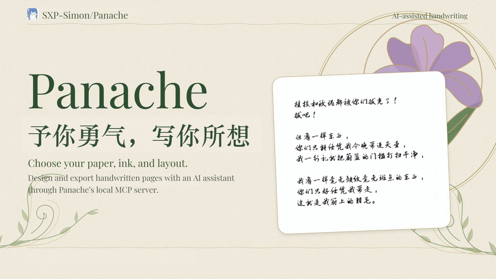
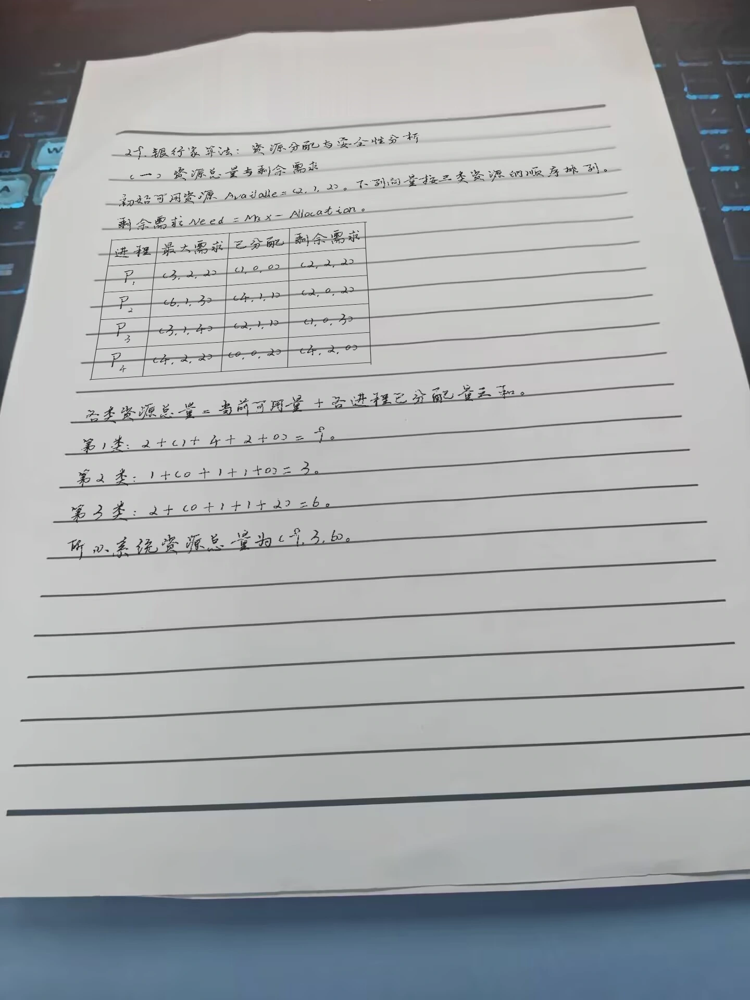
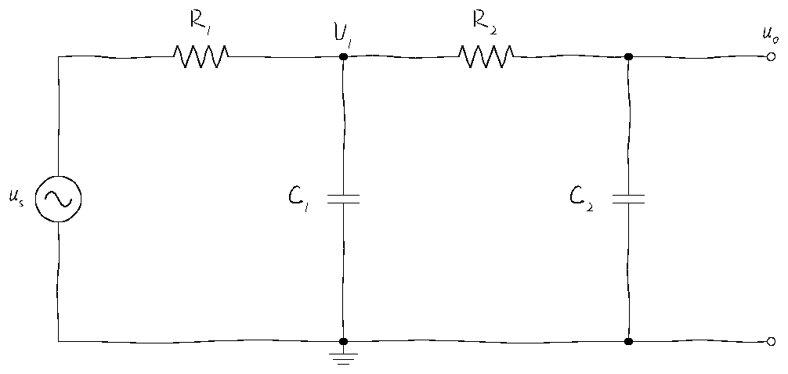

# Panache

[简体中文](README.zh-CN.md)

| Light | Dark |
| --- | --- |
|  |  |

## Demo video

[▶ Watch the Panache demo (72 seconds, in Chinese)](https://heliannuits.me/Panache/assets/panache-promo-6757a4fb253766.mp4)

## The workbench

Panache turns text, equations, tables, and circuit diagrams into handwritten pages. Import a document, choose a handwriting font, and lay it out on a paper template or a photo of your own stationery. Export a single page as PNG or the whole document as a PDF or ZIP of images.

Import TXT, DOCX, PDF, or RTF, or paste text directly. Preview the document, then select handwriting to move it, adjust the ink, or align it with the lines on the paper.

[Download Panache](https://github.com/SXP-Simon/Panache/releases/latest) · [Write your first page](https://heliannuits.me/Panache/en/guide/getting-started/) · [Self-host the web app](https://heliannuits.me/Panache/en/self-hosting/docker/)

Offline downloads are available for Windows x64, macOS on Apple silicon, Linux x64, and Android (arm64-v8a and x86_64). The iOS client currently requires a source build.

## Local MCP for AI clients

The Windows, macOS, and Linux desktop packages include a local MCP server. In **App settings → Connect AI client**, copy the configuration, then add Panache in the MCP settings of an AI client that supports local stdio servers. Reload the client’s MCP settings and ask it to call Panache to list the installed handwriting fonts. The connection works if the Panache tool returns font names.

**Don’t see Connect AI client?** It is not available in the web or mobile app. On a supported desktop, make sure you installed or extracted the whole desktop package, not just the app executable. See the [desktop setup notes](crates/panache-mcp/README.md) for platform details.

Once connected, try asking:

> Write my notes and the process diagram on this photo of my stationery. Show me the first page, then export the whole draft as a PDF.

You can also start with just text. Paste a passage and say whether you want a printable page, writing on a photo of your worksheet, or transparent ink to paste elsewhere. For a photo, the client needs a way to make it available on the computer running Panache. [MCP tools and configuration](crates/panache-mcp/README.md)

| Process state diagram | Resource allocation table |
| --- | --- |
|  |  |

| Flowchart strokes | RC circuit connections |
| --- | --- |
|  |  |

[Handwritten poem](assets/examples/spring-at-qiantang-lake-6806782d66f9.webp)

## Contributing

Report bugs in [GitHub Issues](https://github.com/SXP-Simon/Panache/issues). For local setup, tests, and pull requests, see [CONTRIBUTING.md](CONTRIBUTING.md).

## License

[AGPL-3.0-only](LICENSE)

## Acknowledgments

- Thanks to [14790897/handwriting-web](https://github.com/14790897/handwriting-web) for the original project that inspired Panache.
- Thanks to [AnxForever’s StyleKit](https://github.com/AnxForever/stylekit) for the [Art Nouveau guide](https://www.stylekit.top/zh/styles/art-nouveau) that inspired the workbench’s floral motifs and curves.
- Thanks to [HakimYu](https://github.com/HakimYu) for the Flutter and Rust migration, and to everyone who has [contributed to Panache](https://github.com/SXP-Simon/Panache/graphs/contributors).

Friendship links: [LINUX DO](https://linux.do/)

## Support Simon

If you enjoy Panache, you can buy Simon a coffee. Open WeChat and scan the code below.

