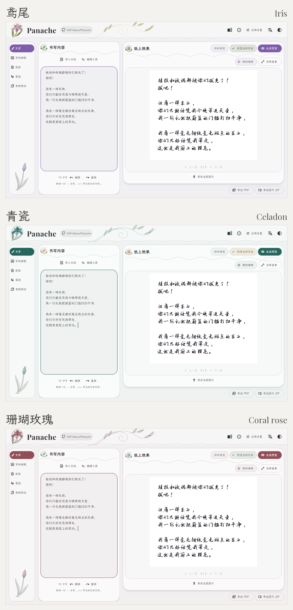
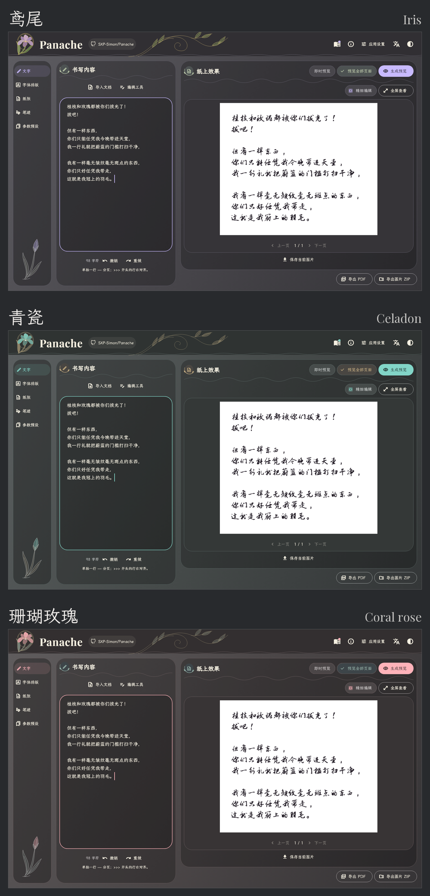
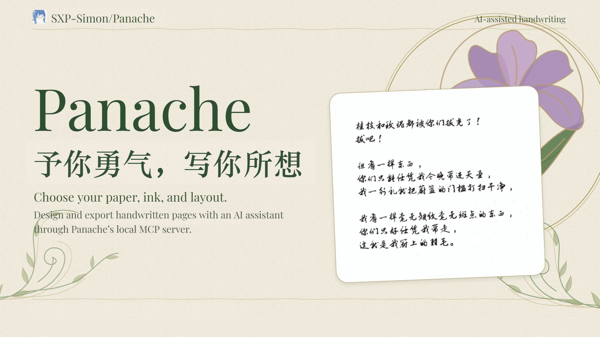
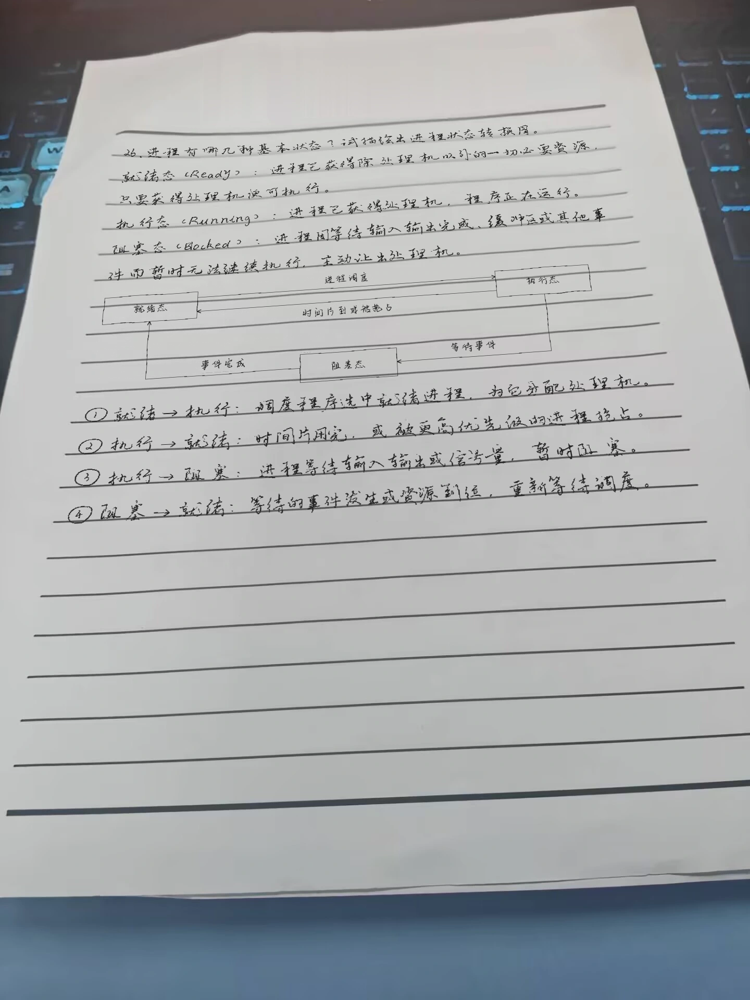
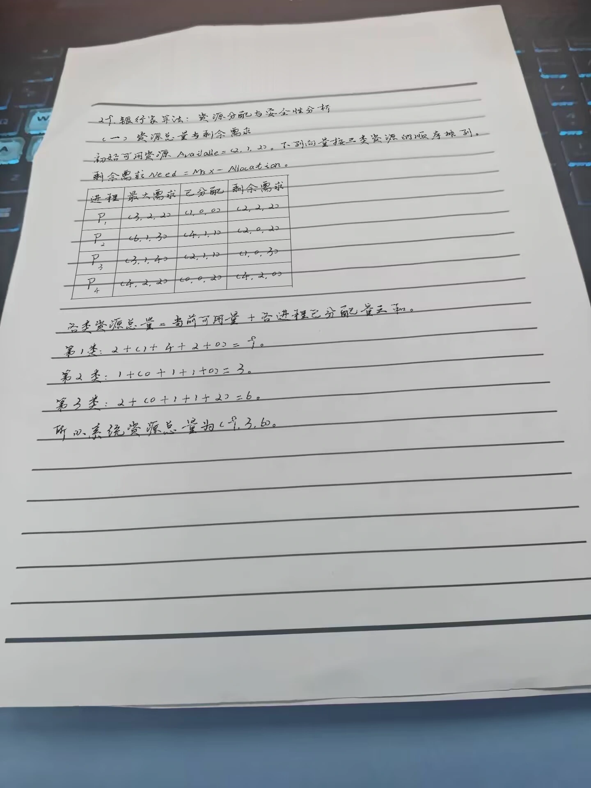
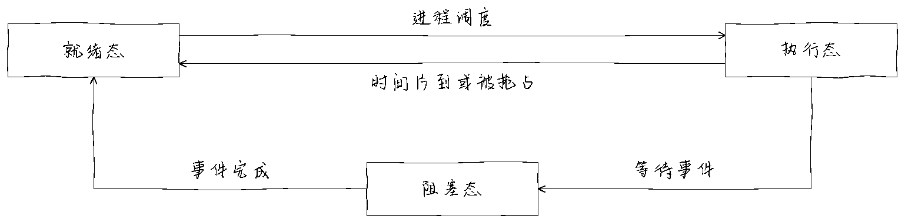
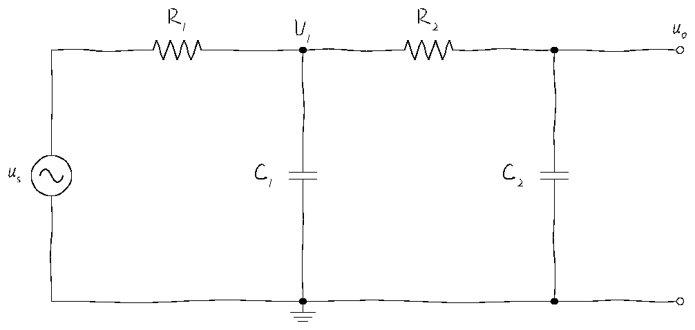
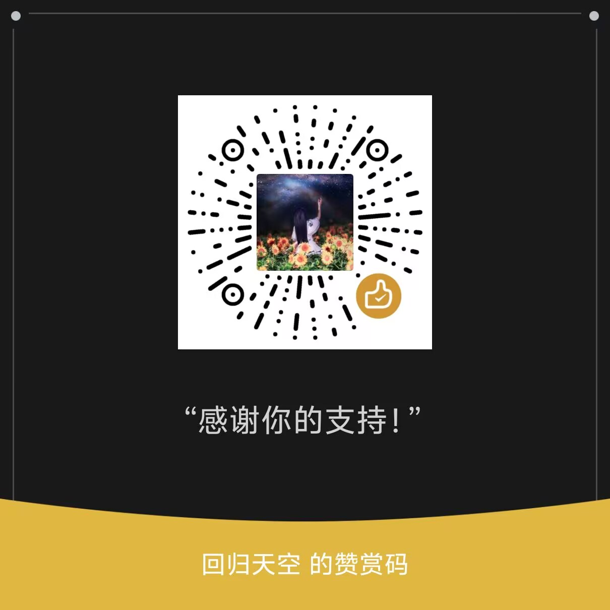

# Panache

[English](README.md) · [简体中文](README.zh-CN.md)

| Açık | Koyu |
| --- | --- |
|  |  |

## Tanıtım videosu

[▶ Panache tanıtımını izleyin (72 saniye, Çince)](https://heliannuits.me/Panache/assets/panache-promo-6757a4fb253766.mp4)

## Çalışma tezgahı

Panache; metinleri, denklemleri, tabloları ve devre şemalarını el yazısı sayfalara dönüştürür. Bir belgeyi içe aktarın, bir el yazısı yazı tipi seçin ve bunu bir kağıt şablonunun veya kendi kırtasiye kağıdınızın fotoğrafının üzerine yerleştirin. Tek bir sayfayı PNG olarak ya da tüm belgeyi PDF veya görsellerden oluşan bir ZIP arşivi olarak dışa aktarın.

TXT, DOCX, PDF veya RTF içe aktarın ya da doğrudan metin yapıştırın. Belgeyi önizleyin, ardından el yazısını seçerek taşıyın, mürekkebi ayarlayın veya kağıttaki çizgilerle hizalayın.

[Panache'ı İndirin](https://github.com/SXP-Simon/Panache/releases/latest) · [İlk sayfanızı yazın](https://heliannuits.me/Panache/en/guide/getting-started/) · [Web uygulamasını kendiniz barındırın](https://heliannuits.me/Panache/en/self-hosting/docker/)

Çevrimdışı indirmeler Windows x64, Apple silicon üzerinde macOS, Linux x64 ve Android (arm64-v8a ve x86_64) için mevcuttur. iOS istemcisi şu anda kaynaktan derleme gerektirmektedir.

## Yapay zeka istemcileri için yerel MCP

Windows, macOS ve Linux masaüstü paketleri yerel bir MCP sunucusu içerir. **App settings → Connect AI client** bölümünde yapılandırmayı kopyalayın, ardından yerel stdio sunucularını destekleyen bir yapay zeka istemcisinin MCP ayarlarına Panache'ı ekleyin. İstemcinin MCP ayarlarını yeniden yükleyin ve kurulu el yazısı yazı tiplerini listelemek için Panache'ı çağırmasını isteyin. Panache aracı yazı tipi adlarını döndürürse bağlantı çalışıyor demektir.

**Connect AI client seçeneğini göremiyor musunuz?** Bu seçenek web veya mobil uygulamada mevcut değildir. Desteklenen bir masaüstünde, yalnızca uygulama çalıştırılabilir dosyasını değil tüm masaüstü paketini kurduğunuzdan veya çıkardığınızdan emin olun. Platform ayrıntıları için [masaüstü kurulum notlarına](crates/panache-mcp/README.md) bakın.

Bağlandıktan sonra şunu sormayı deneyin:

> Write my notes and the process diagram on this photo of my stationery. Show me the first page, then export the whole draft as a PDF.

Fotoğraf için istemciye Panache'ın çalıştığı bilgisayarda erişilebilir bir dosya yolu verin. Modeline görsel ileten bir istemci, bitmiş sayfayı inceleyebilir ve seçilen bir alanı gözden geçirebilir. Yalnızca metin destekleyen bir istemcide ölçümleri isteyin ve görünümü değerlendirmek için dışa aktarılan PDF'i yerel olarak açın. [MCP araçları ve yapılandırma](crates/panache-mcp/README.md)

Yalnızca metin için pasajı yapıştırın ve yazdırılabilir bir sayfa mı, çalışma kağıdınız üzerine yazı mı yoksa bir poster için şeffaf mürekkep mi istediğinizi belirtin.

| Süreç durum diyagramı | Kaynak tahsis tablosu |
| --- | --- |
|  |  |

| Akış şeması çizgileri | RC devre bağlantıları |
| --- | --- |
|  |  |

[El yazısı şiir](assets/examples/spring-at-qiantang-lake-6806782d66f9.webp)

### Fotoğraflanmış kağıt üzerine el yazısı

Panache'ın MCP sunucusu, çizgisiz kağıt içeren iki fotoğraf üzerine örnek bir STEM ödevi yerleştirdi. Tam çözünürlüklü PNG'yi açmak için bir sayfayı seçin.

| Ahşap masa üzerinde çizgisiz kağıt | Çiçek yanında gölgedeki kağıt |
| --- | --- |
|  |  |

Orijinal fotoğraflar · [Kaboompics](https://www.pexels.com/photo/empty-paper-sheet-on-wooden-table-4207708/) · [Andrzej Gdula](https://www.pexels.com/photo/white-printer-paper-on-brown-wooden-table-11485123/)

## Katkıda Bulunma

Hataları [GitHub Issues](https://github.com/SXP-Simon/Panache/issues) üzerinden bildirin. Yerel kurulum, testler ve pull request'ler için [CONTRIBUTING.md](CONTRIBUTING.md) dosyasına bakın.

## Lisans

[AGPL-3.0-only](LICENSE)

## Teşekkürler

- Panache'a ilham veren orijinal proje için [14790897/handwriting-web](https://github.com/14790897/handwriting-web) deposuna teşekkürler.
- Çalışma tezgahının çiçek motiflerine ve kıvrımlarına ilham veren [Art Nouveau kılavuzu](https://www.stylekit.top/zh/styles/art-nouveau) için [AnxForever’s StyleKit](https://github.com/AnxForever/stylekit) projesine teşekkürler.
- Flutter ve Rust geçişi için [HakimYu](https://github.com/HakimYu)'ya ve [Panache'a katkıda bulunan](https://github.com/SXP-Simon/Panache/graphs/contributors) herkese teşekkürler.

Dost bağlantılar: [LINUX DO](https://linux.do/)

## Simon'a Destek Olun

Panache'ı beğendiyseniz Simon'a bir kahve ısmarlayabilirsiniz. WeChat'i açın ve aşağıdaki kodu tarayın.

