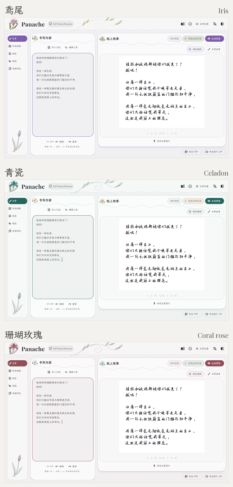
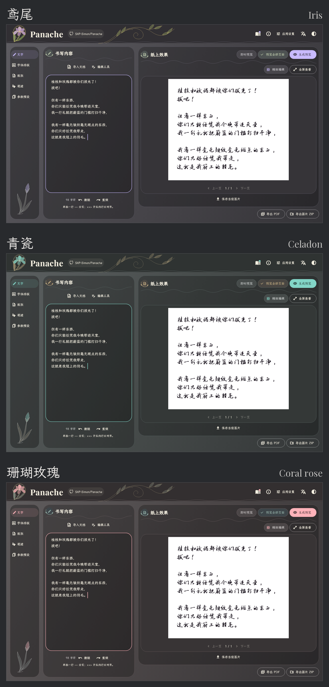
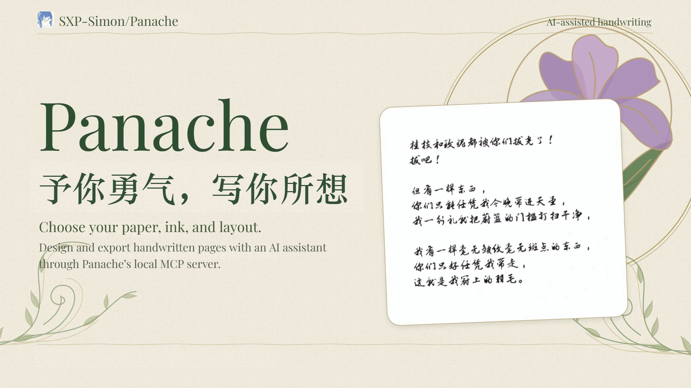
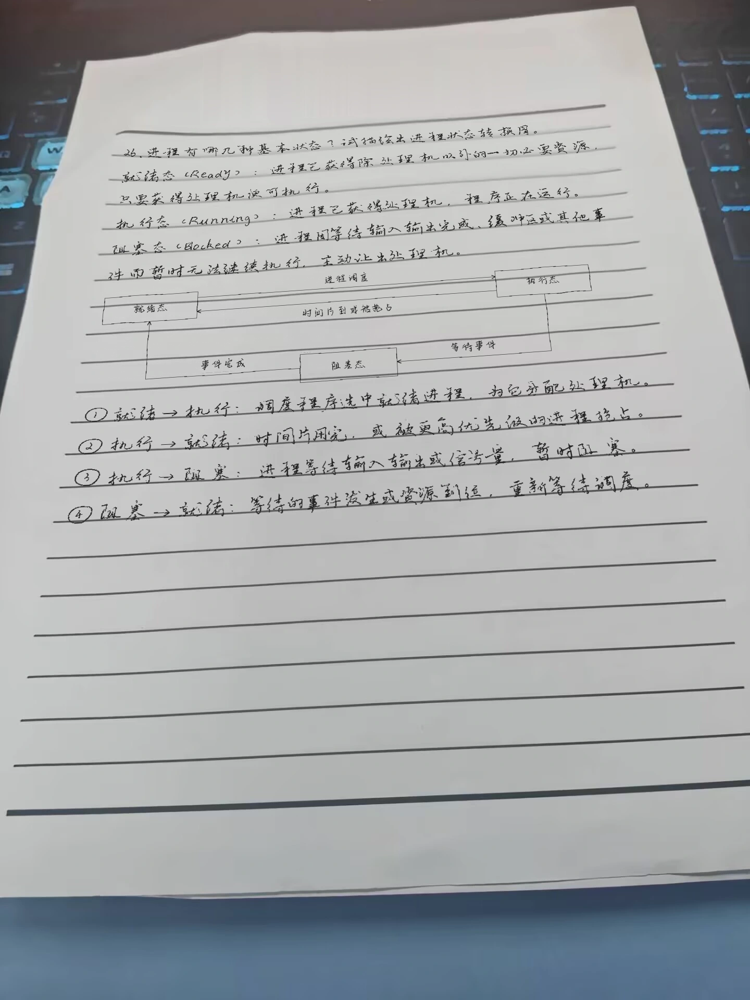
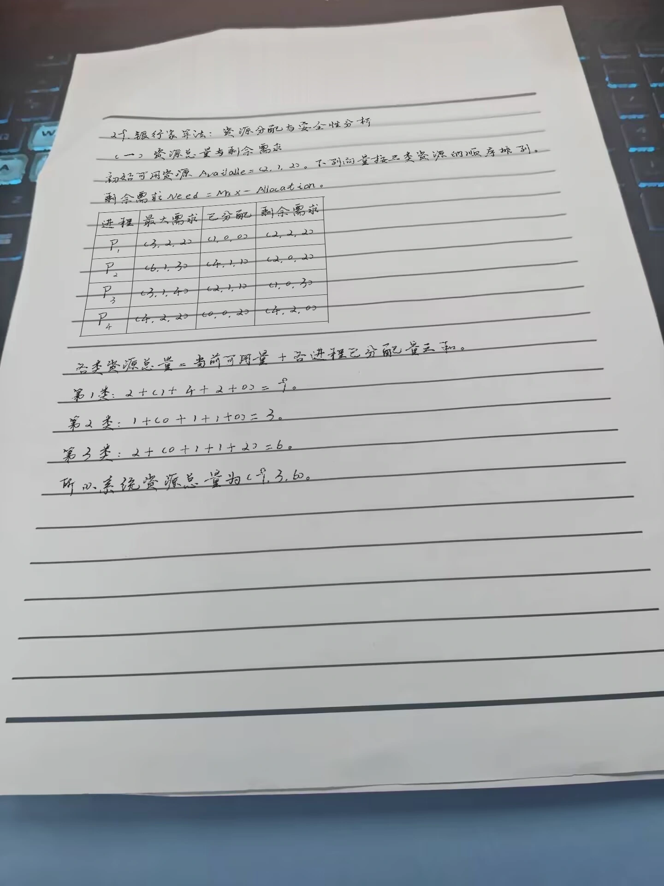
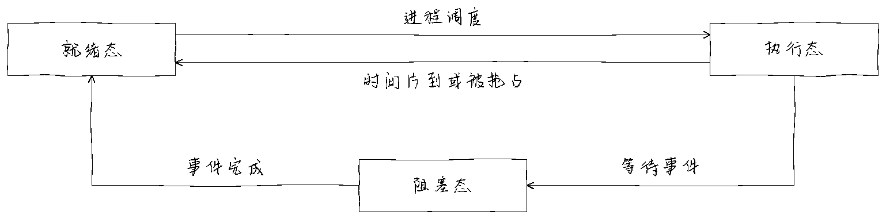
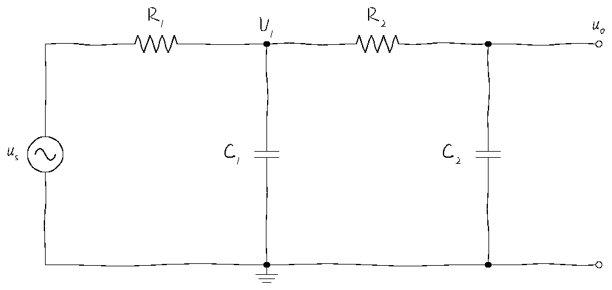

# Panache

[English](README.md)

| 浅色 | 深色 |
| --- | --- |
|  |  |

## 展示视频

[▶ 播放《让文字落在纸上》（72 秒）](https://heliannuits.me/Panache/assets/panache-promo-6757a4fb253766.mp4)

## 手写工作台

Panache 能把正文、公式、表格和电路图排成手写稿。导入文档，选好手写字体，就能写在内置纸样或自己拍的信纸上。单页可保存为 PNG，整篇可导出为 PDF，也可以把各页图片打包为 ZIP。

可以直接粘贴文字，也可以导入 TXT、DOCX、PDF 或 RTF。预览整篇后，圈选需要调整的字，就能移动位置、调整墨色，或让字迹贴合纸上的横线。

[下载 Panache](https://github.com/SXP-Simon/Panache/releases/latest) · [写下第一页](https://heliannuits.me/Panache/guide/getting-started/) · [自行部署网页版](https://heliannuits.me/Panache/self-hosting/docker/)

可下载的离线客户端支持 Windows x64、Apple 芯片 Mac、Linux x64 和 Android（arm64-v8a、x86_64）。iOS 客户端目前需要从源码构建。

## 用 AI 客户端生成手写稿

Windows、macOS 和 Linux 桌面版随附本地 MCP 服务。在 **应用设置 → 连接 AI 客户端** 复制配置，加入支持 stdio MCP 的客户端，就可以对它说：

> 用这张斜拍的信纸排我的笔记，画出进程状态转换图。先给我看第一页，确认后把整份导出成 PDF。

请提供运行 Panache 的电脑能读取的照片路径。能向模型传递图片的客户端可以检查成品、放大复盘选区。在纯文字客户端中，可让 AI 说明测量结果，再打开导出的本地 PDF 看实际效果。[MCP 工具与配置说明](crates/panache-mcp/README.md)

只有文字也可以开始。贴上正文，说清是要打印、填进练习纸，还是只取透明字迹贴进海报。

| 进程状态转换图 | 资源分配表 |
| --- | --- |
|  |  |

| 流程图线条近景 | RC 电路接线近景 |
| --- | --- |
|  |  |

[《钱塘湖春行》](assets/examples/spring-at-qiantang-lake-6806782d66f9.webp)

## 参与贡献

遇到问题可以到 [GitHub Issues](https://github.com/SXP-Simon/Panache/issues) 反馈。本地开发、测试和提交 PR 的说明见[贡献指南](CONTRIBUTING.md#中文贡献指南)。

## 许可

[AGPL-3.0-only](LICENSE)

## 致谢

- 感谢 [14790897/handwriting-web](https://github.com/14790897/handwriting-web) 提供原版项目，为 Panache 带来灵感。
- 感谢 [AnxForever 的 StyleKit](https://github.com/AnxForever/stylekit)。工作台的花卉装饰和曲线设计参考了它的[新艺术运动风格指南](https://www.stylekit.top/zh/styles/art-nouveau)。
- 感谢 [HakimYu](https://github.com/HakimYu) 完成 Flutter 与 Rust 迁移，也感谢每一位[为 Panache 作出贡献的人](https://github.com/SXP-Simon/Panache/graphs/contributors)。

Friendship links: [LINUX DO](https://linux.do/)

## 支持作者

如果你喜欢 Panache，可以请 Simon 喝杯咖啡。打开微信，用「扫一扫」扫描下方赞赏码。

