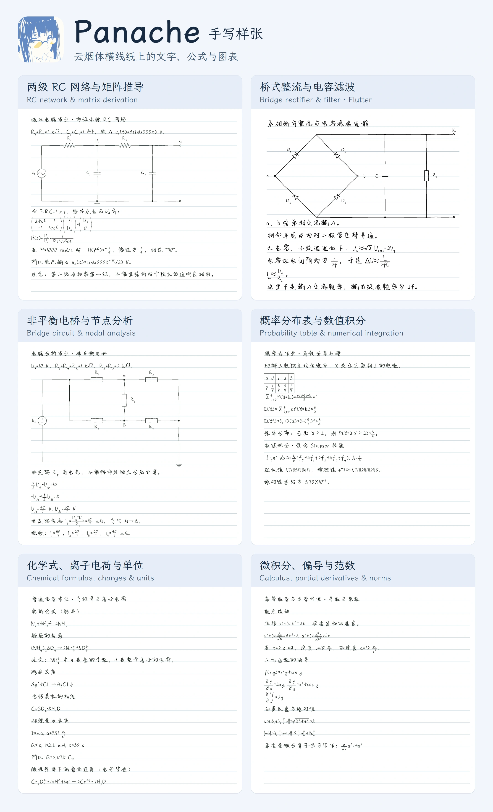
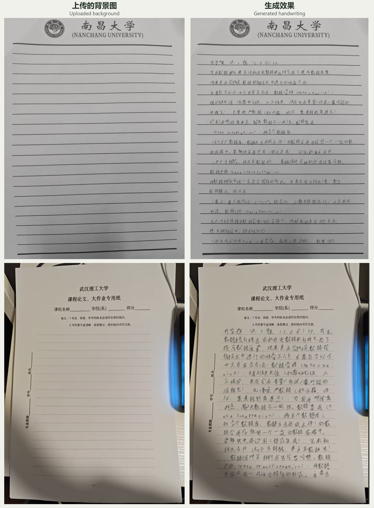
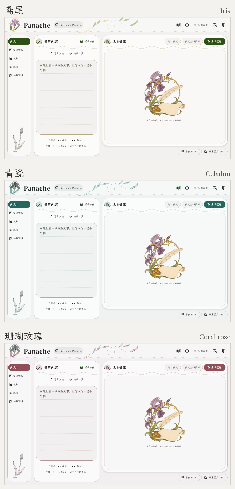
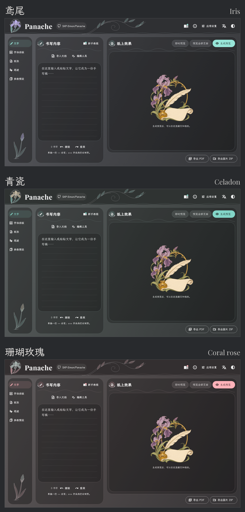

# Panache

[简体中文](README.md)

Panache is an open-source handwriting generator built with **Flutter and Rust**. Lay out class notes and lab reports with prose, formulas, tables, and circuit diagrams, then export handwritten pages.

[Download](https://github.com/SXP-Simon/Panache/releases/latest) · [Client guide](app/README.md) · [Self-hosting](deploy/rust/README.md)


<table>
  <thead>
    <tr>
      <th width="45%">Ruled notebook samples</th>
      <th width="55%">Custom backgrounds and generated handwriting</th>
    </tr>
  </thead>
  <tbody>
    <tr>
      <td align="center" valign="top"><a href="docs/assets/images/panache-showcase.webp"></a></td>
      <td align="center" valign="top"><a href="docs/assets/images/panache-custom-background.webp"></a></td>
    </tr>
  </tbody>
</table>

- Android / iOS use a bundled Rust engine through Dart FFI.
- Windows / macOS / Linux automatically start a bundled Rust sidecar.
- Flutter Web connects to a Rust HTTP service that can also host the UI.

Light mode uses a warm, paper-white background. Dark mode layers translucent black over neutral gray to distinguish the navigation, writing area, and preview.

<table>
  <thead>
    <tr>
      <th width="50%">Light workbench</th>
      <th width="50%">Dark workbench</th>
    </tr>
  </thead>
  <tbody>
    <tr>
      <td valign="top"><a href="docs/assets/images/panache-themes-light-392cf122e893.webp"></a></td>
      <td valign="top"><a href="docs/assets/images/panache-themes-dark-345fc743686a.webp"></a></td>
    </tr>
  </tbody>
</table>

## Handwriting and layout

- **Text and documents**　Type, paste, or import TXT, DOCX, PDF, or RTF. Insert an illustration at the cursor. Use a line containing `---` to start a new page or prefix a line with `>>>` to align it to the right.
- **Math and circuits**　Render stacked fractions, radicals, matrices, scripts, and common mathematical symbols. Fallback fonts supply missing glyphs. Supported CircuiTikZ circuits render on the page.
- **Markdown tables**　Use **Editing tools → Prepare text** to clean pasted text and choose handwriting grid, aligned text, or list layouts. Ruled LaTeX `array` tables can include fractions in their cells.
- **Fonts and paper**　Choose separate Chinese and Latin fonts and let digits follow the Latin font if desired. Select blank, ruled, grid, or dot paper, or upload a photo and detect or select the writing area.
- **Fine editing and export**　Preview one page or all pages. Select characters to move them, adjust their ink, or reshape a selection using corner perspective. A full-screen editor is available on phones. Save one PNG, or export all pages as a PDF or image ZIP.

Open **Guide** in the workbench to follow the four steps from writing your first draft to exporting it.

## Layout

| Path | Purpose |
| --- | --- |
| `app/` | Flutter client, platform projects, and tests |
| `assets/` | Shared font assets as a Flutter package |
| `crates/` | Rust rendering core, mobile bridge, and HTTP server |
| `scripts/` | Desktop, mobile, and service build scripts |
| `deploy/rust/` | Docker and service deployment |
| `VERSION` | Product version |

## Development

Toolchain: Flutter 3.47.5 / Dart 3.13.4 and Rust 1.94.1, plus the SDK for each native platform. Python is only used by native build scripts.

```bash
# Repository root
cargo run --locked -p handwriting-server
# Another terminal
cd app
flutter pub get
python3 ../scripts/build-text-worker.py
flutter run -d chrome --dart-define=API_BASE_URL=http://127.0.0.1:5006
```

For cross-origin development, configure `HANDWRITING_ALLOWED_ORIGINS`. See the [client guide](app/README.md), [Rust workspace guide](crates/README.md), and [deployment guide](deploy/rust/README.md) for builds, tests, signing, and platform limitations.

Releases build Flutter and Rust from a checked commit on `main`. See the [release guide](docs/release.md). The former Web/Electron source is archived on `backup`.

## Credits and licensing

Panache is based on [handwriting-web](https://github.com/14790897/handwriting-web). Thanks to [HakimYu](https://github.com/HakimYu) for the Flutter/Rust migration.

See [LICENSE](LICENSE) and the algorithm [NOTICE](crates/handwriting-core/NOTICE). Font redistribution is subject to each font's license.
